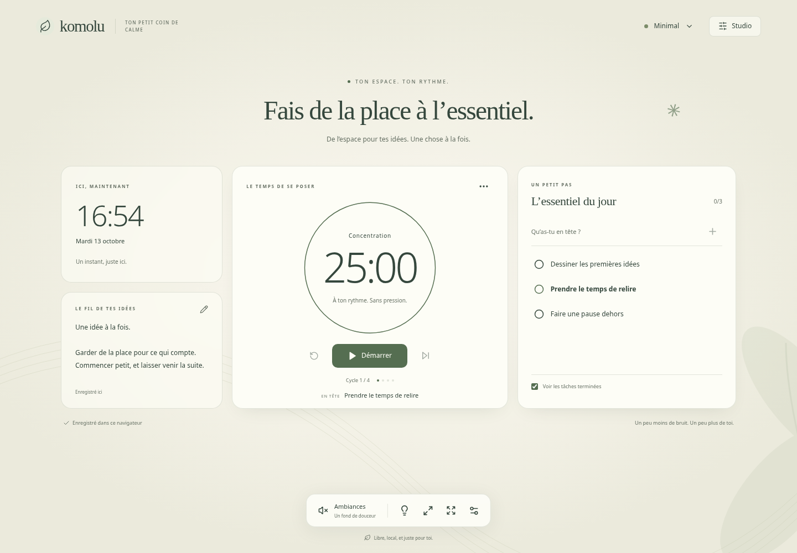

# Komolu

**Ton espace. Ton rythme. Ta concentration.**

Un petit coin de calme, libre et personnalisable. Choisis une ambiance, pose une tâche et lance une session. Sans compte, sans publicité, sans serveur de données.



**V1.0.0** · [Code source](https://github.com/raphplt/Komolu) · [Installation Docker](docs/self-hosting.md) · [Contribuer](CONTRIBUTING.md)

**[Ouvrir Komolu](https://raphplt.github.io/Komolu/)** — instance publique publiée le 13 octobre 2026 via GitHub Pages.

## Un espace prêt à utiliser

- Trois décors originaux : **Minimal**, **Cozy** et **Deep Work**. Crée, duplique et renomme tes propres espaces.
- **Studio** : déplace, redimensionne et masque les widgets à la souris ou au clavier ; règle l'horloge et compose ton fond avec une image ou une vidéo locale.
- **Minuterie** : 25/5, 50/10, durée libre ou séquence personnalisée ; pause, reprise, répétitions et son de fin facultatif. La session survit au rechargement.
- **Tâches, notes et pensées** : données personnelles communes à tous les espaces, sauvegardées dans ce navigateur.
- **Ambiances** : cinq textures synthétiques originales — bruit brun, pluie, vent, feu et vagues — avec mixeur, volumes et sons personnels. Ce ne sont pas des enregistrements de nature.
- **Focus**, plein écran, mouvements réduits et raccourcis désactivables.
- **Sauvegarde complète** et **partage d'espace** : deux exports distincts ; un espace partagé n'emporte ni tâches, ni notes, ni pensées, ni médias personnels.

[Cozy](docs/screenshots/cozy.png) · [Deep Work](docs/screenshots/deep.png) · [Studio](docs/screenshots/studio.png) · [Mobile](docs/screenshots/mobile.png)

## Démarrer en développement

Node **24.21.0** (voir `.nvmrc`) et npm. Depuis le dépôt :

```bash
nvm use
npm ci --include=dev
npm run dev
```

Ouvre [localhost:5173](http://localhost:5173). `nvm` est facultatif si Node 24 est déjà installé. Le serveur de développement écoute sur toutes les interfaces ; utilise `npm run dev -- --host 127.0.0.1` pour le limiter à ta machine.

| Commande                                  | Usage                                 |
| ----------------------------------------- | ------------------------------------- |
| `npm run dev`                             | Développement avec rechargement       |
| `npm run build`                           | TypeScript + production dans `dist/`  |
| `npm run preview`                         | Prévisualisation locale du build      |
| `npm run lint` / `npm run typecheck`      | Analyse statique                      |
| `npm run format` / `npm run format:check` | Mise en forme / vérification Prettier |
| `npm test`                                | Tests unitaires                       |
| `npm run test:e2e`                        | Parcours Chromium et Firefox          |
| `npm run test:e2e:ui`                     | Explorateur Playwright                |

Avant les tests navigateur : `npx playwright install --with-deps chromium firefox`. Les détails et limites sont dans [docs/testing.md](docs/testing.md).

## Auto-héberger

Avec Docker et Docker Compose :

```bash
docker compose up --build --detach --wait
```

Ouvre [127.0.0.1:8080](http://127.0.0.1:8080). Aucun compte, base de données ou volume utilisateur à configurer : le conteneur sert uniquement les fichiers statiques. Pour l'exposer sur Internet, place un reverse proxy HTTPS devant ce port. [Guide complet](docs/self-hosting.md).

## Tes données restent dans ton navigateur

Komolu ne contient ni analytics, ni télémétrie, ni appel à une API distante. L'hébergeur sert les fichiers et peut disposer de journaux HTTP ordinaires ; tes notes et médias ne lui sont pas envoyés. IndexedDB conserve les données par **origine** (protocole + hôte + port) et profil de navigateur. Changer d'instance, de navigateur ou de port crée un autre stockage. Effacer les données du navigateur peut tout supprimer.

**Télécharge régulièrement une sauvegarde** depuis Préférences → Sauvegarde et données. Le fichier JSON contient données et médias, n'est pas chiffré et peut devenir volumineux (base64). Limites : 50 Mio par média, 150 Mio de médias au total, 220 Mio par fichier d'import ; sons personnels limités à 120 secondes et 2 canaux. Les détails de validation, fusion et remplacement sont dans [Portabilité](docs/portability.md) et [Médias](docs/media.md).

Raccourcis hors champ de saisie : **Espace** démarre/met en pause, **N** capture une pensée, **F** bascule Focus, **Échap** ferme un panneau. Ils se désactivent dans Préférences.

## Périmètre et suite

Cette V1 est une application statique en français. PWA et installation hors ligne, synchronisation entre appareils, salles de coworking, chat, voix et configuration de marque à l'exécution sont reportés. Aucun backend n'est anticipé. Les tests automatisés ne remplacent pas une bêta humaine ; Safari/iOS et l'écoute réelle des ambiances restent à valider.

[Architecture](docs/architecture.md) · [Plan de livraison](IMPLEMENTATION_PLAN.md) · [Changelog](CHANGELOG.md) · [Fiche de vision originale](docs/product.md)

## Licence

[MIT](LICENSE), © 2026 Komolu contributors. [Licences des ressources](ASSETS_LICENSES.md) et [notices des dépendances](public/THIRD_PARTY_NOTICES.txt). Komolu est un nom de travail ; sa disponibilité juridique n'est pas garantie.
